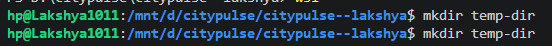
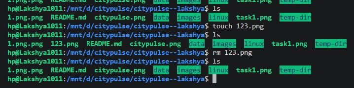
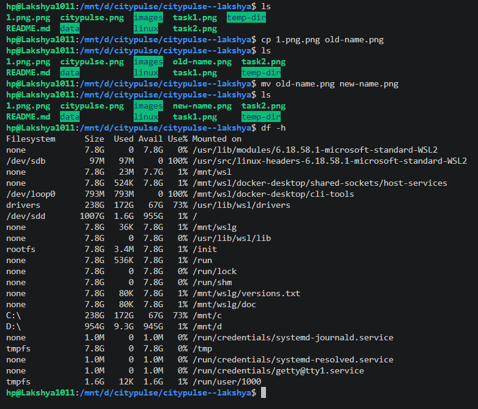
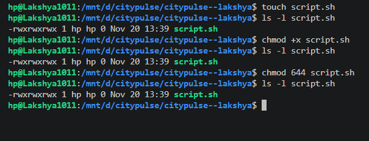
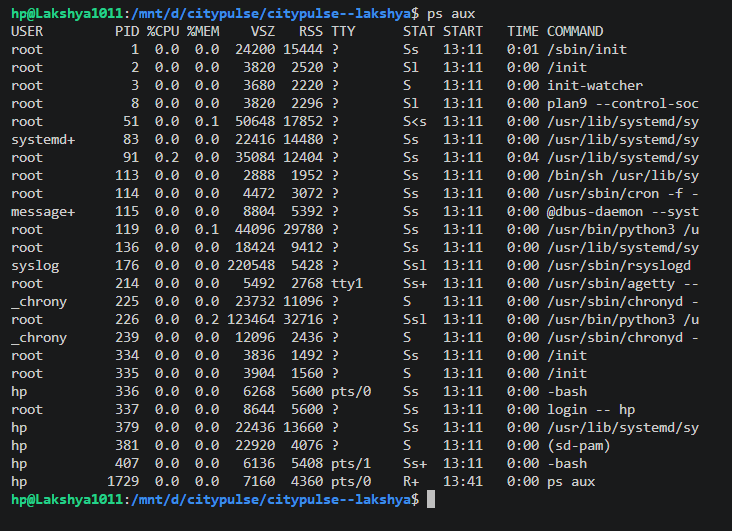

# Atria-CityPulse

This repository documents basic Linux command-line tasks, with terminal screenshots.

## Task 1: Create and Remove an Empty Directory

Use `mkdir` to create a directory and `rmdir` to remove it when it is empty:

```bash
mkdir temp-dir
rmdir temp-dir
```

`rmdir` only works when the directory is empty. Use `rm -r` or `rm -rf` to remove directories that contain files or subdirectories.



## Task 2: Remove Files and Directories Recursively

Use `rm` to remove a file, and `rm -r` or `rm -rf` to remove a directory and everything inside it:

```bash
# Remove a file
rm filename.txt

# Remove a directory and its contents
rm -r folder-name

# Remove a directory and its contents without prompting
rm -rf folder-name
```

> **Warning:** `rm -rf` permanently deletes data. Double-check the path before running it.



## Task 3: Rename Files and Check Disk Usage

### Rename a File or Directory

Use `mv` to rename a file or directory:

```bash
mv old-name.txt new-name.txt
mv old-folder-name new-folder-name
```

To move and rename a file at the same time:

```bash
mv file.txt folder/newname.txt
```

### Check Disk Usage

Use `df -h` to see available disk space on mounted filesystems:

```bash
df -h
```

Use `du -h` to show the size of files and directories:

```bash
# Show sizes in the current directory and its subdirectories
du -h

# Show only the total size of the current directory
du -sh

# Show the total size of a specific folder
du -sh folder-name
```



## Task 4: Linux Permissions

Linux files and directories have three permission types:

| Permission | Symbol | Meaning |
|------------|--------|---------|
| Read       | `r`    | View file contents or list directory contents |
| Write      | `w`    | Modify a file or change directory contents |
| Execute    | `x`    | Run a file as a program or enter a directory |

Permissions are assigned to the file owner, the owner's group, and other users.

Use `ls -l` to view permissions and `chmod` to change them:

```bash
# View permissions
ls -l

# Add execute permission for the owner
chmod u+x script.sh

# Give the owner read and write permissions
chmod u+rw file.txt

# Make a file readable and writable by everyone
chmod 666 file.txt

# Owner: read/write/execute; group and others: read/execute
chmod 755 script.sh
```

Numeric permission values are read = 4, write = 2, and execute = 1. For example, `755` means owner `rwx` (7), group `r-x` (5), and others `r-x` (5).



## Task 5: List Running Processes

```bash
# List processes
ps aux

# Live view of processes (press q to quit)
top

# Find a process by name
ps aux | grep python

# Find a process ID by name
pgrep python

# Stop a process by its ID
kill <PID>
```

